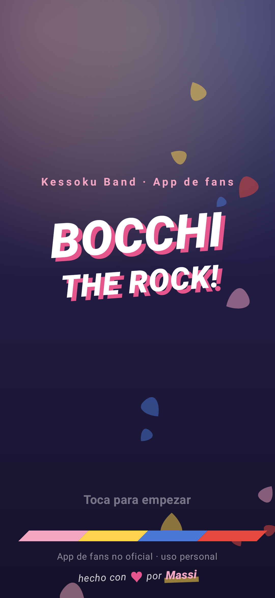
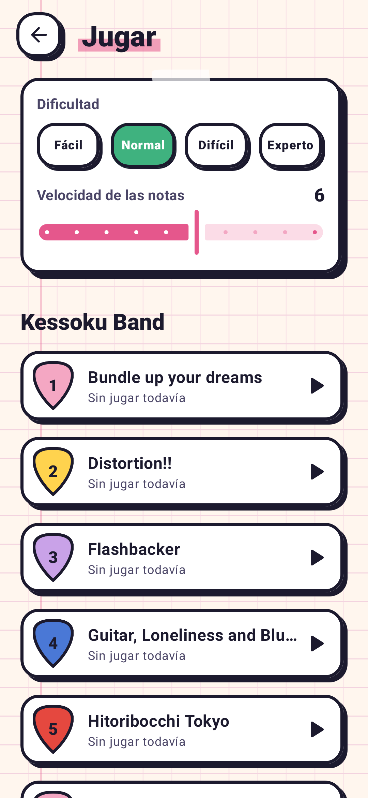
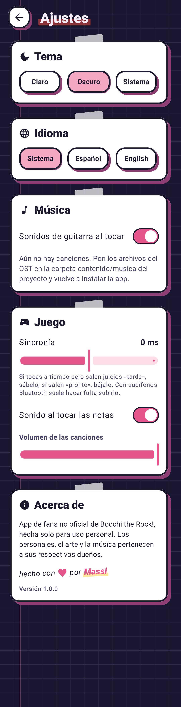
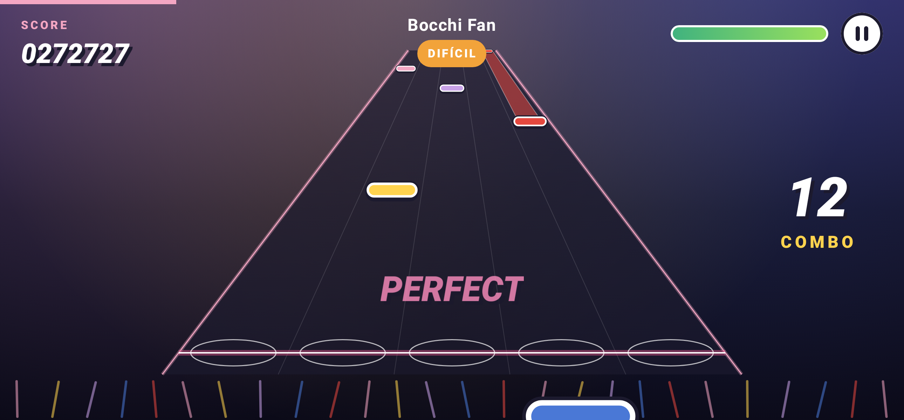
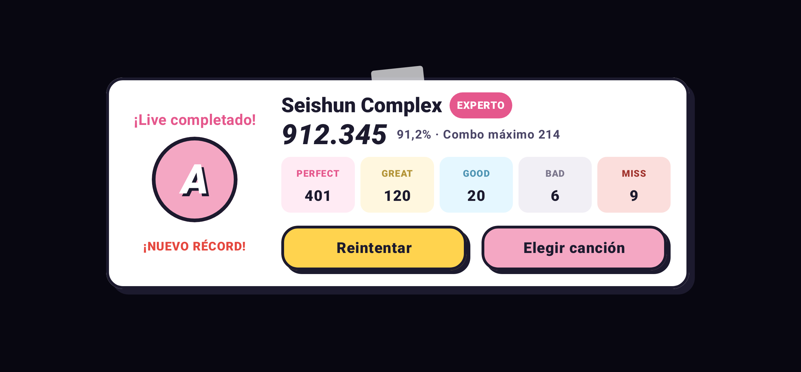

# 🎸 Bocchi Fan — app de fans de *Bocchi the Rock!*

App para Android hecha con cariño por fans de **Bocchi the Rock!**: un juego de ritmo con las canciones
de Kessoku Band, fichas de los personajes, un reproductor con letras y mucho estilo "cuaderno con stickers".

**Versión 1.0.0** · Kotlin + Jetpack Compose · Android 8.0 o superior

<p align="center">
  
  
  
</p>
<p align="center">
  
</p>
<p align="center">
  
</p>

---

## ✨ Qué tiene

- 🎮 **Juego de ritmo** estilo *Guitar Hero* / *BanG Dream*
  - 5 carriles en perspectiva, en horizontal.
  - **Las notas se crean solas analizando el audio** (no hay que hacerlas a mano).
  - 4 dificultades: Fácil, Normal, Difícil y Experto.
  - Juicios PERFECT / GREAT / GOOD / BAD / MISS, combo, vida y puntuación de hasta 1 000 000.
  - Cut-ins de Kessoku Band cada 50 de combo, festejo de FULL COMBO / ALL PERFECT y récords por canción.
  - Fondos de concierto animados (uno al azar por canción).
- 👥 **Personajes**: 12 fichas con edad, estatura, cumpleaños, seiyū, biografía y curiosidades.
- 🎧 **Reproductor** con la portada de cada canción, aleatorio/repetir y **letras**: el botón *Buscar*
  abre el navegador, pegas la letra y se guarda. Si trae tiempos (LRC), se ilumina al ritmo.
- 🎵 **OST de fondo** en los menús y **sonidos de guitarra** con estrellitas al tocar cada botón.
- 🌙 **Tema claro y oscuro**, y textos en **español e inglés**.

---

## 🛠️ Cómo compilarla

**Necesitas:** JDK 17 y el Android SDK 35 (lo trae Android Studio).

```bash
git clone <url-de-este-repositorio>
cd "<carpeta>/BocchiFan"
./gradlew assembleDebug          # en Windows: gradlew.bat assembleDebug
```

El APK queda en `BocchiFan/app/build/outputs/apk/debug/app-debug.apk`.
Para instalarlo en un teléfono conectado por USB:

```bash
adb install -r app/build/outputs/apk/debug/app-debug.apk
```

También puedes abrir la carpeta `BocchiFan/` en **Android Studio** y pulsar ▶ Run.

---

## 📁 Pon tu propio contenido

Por derechos de autor, **este repositorio no incluye música, GIFs ni imágenes del anime**.
La app funciona sin ellos (muestra diseños de reemplazo), pero para la experiencia completa pon tus
archivos en `contenido/` y vuelve a compilar:

| Carpeta | Qué va ahí |
|---|---|
| `contenido/canciones/<Álbum>/` | Canciones (.mp3) para **Jugar** y para el **reproductor**. Una subcarpeta por álbum. |
| `contenido/musica/` | El OST que suena de fondo en los menús. |
| `contenido/imagenes/personajes/` | Retratos: `bocchi.png`, `nijika.png`, `ryo.png`, `kita.png`… |
| `contenido/imagenes/escenario/` | GIFs de fondo del juego (una subcarpeta por escena). |
| `contenido/imagenes/carga/` | GIFs de la pantalla de carga. |
| `contenido/imagenes/bocchi/` | La Bocchi "cute" del menú. |

Cada carpeta tiene un `LEEME.txt` con los detalles. Las fichas de personajes están en
`contenido/datos/personajes.json` y se pueden editar.

---

## 🧭 ¿Cómo está hecha?

Toda la explicación, pensada para principiantes (estructura, cómo funciona el detector de ritmo, el
dibujo en perspectiva, la historia del proyecto…), está en **[ARQUITECTURA.md](ARQUITECTURA.md)**.

```
BocchiFan/       → proyecto Android (código Kotlin + Compose)
contenido/       → música, imágenes y datos que pone cada persona
herramientas/    → BocchiTools.java: genera los sonidos de guitarra y recorta stickers
docs/capturas/   → imágenes de este README
```

Pruebas automáticas (desde `BocchiFan/`):

```bash
./gradlew testDebugUnitTest      # lógica del juego, detector de golpes, letras
./gradlew recordRoborazziDebug   # capturas de todas las pantallas
```

---

## ⚠️ Aviso

Proyecto **de fans, no oficial y sin fines de lucro**, hecho para uso personal.
*Bocchi the Rock!*, sus personajes, su arte y su música pertenecen a sus respectivos dueños
(Aki Hamaji / Houbunsha / Aniplex / CloverWorks). Los datos de los personajes se consultaron en la
[Bocchi the Rock! Wiki](https://bocchi-the-rock.fandom.com/) y las biografías están escritas con
palabras propias. Los sonidos de la app se generaron por síntesis y el diseño es original.

---

<p align="center">Hecho con ♥ por <b>Massi</b></p>
